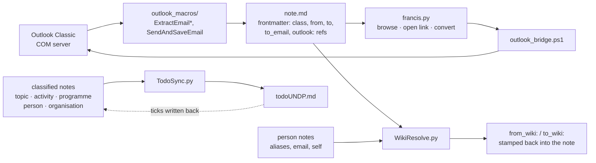
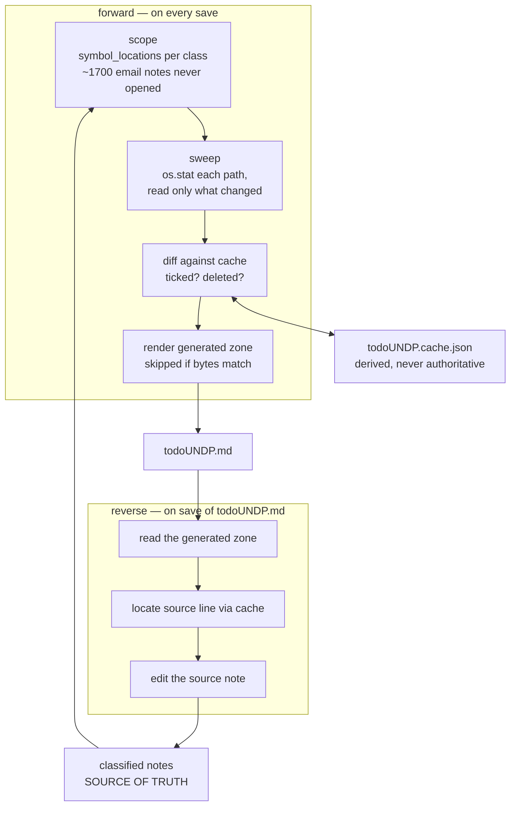
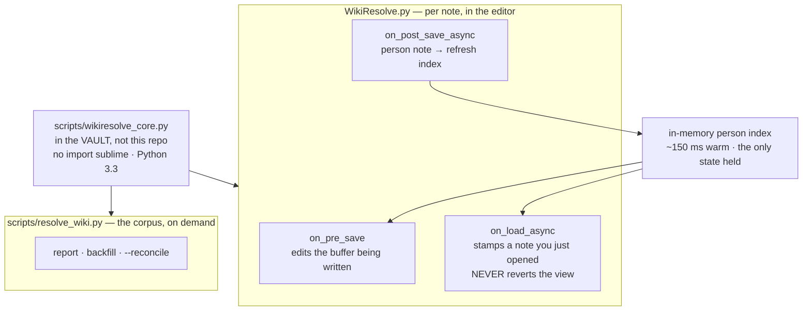
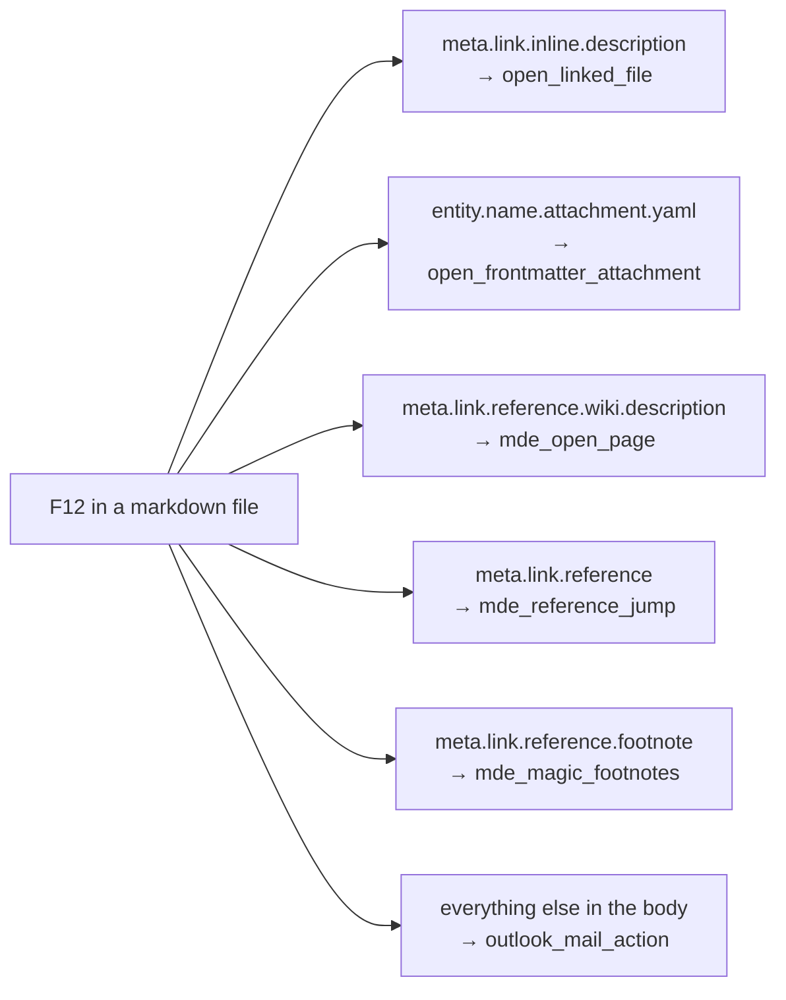
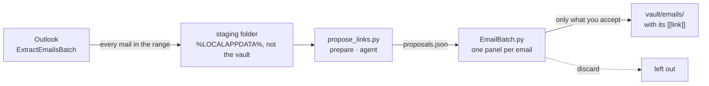

# Markdown-Note-Harness

A Sublime Text 4 package that turns a folder of Markdown notes into a working
inbox: wiki-linking, todo syncing, Office-to-Markdown conversion, and a bridge
back to the Outlook Classic messages the email notes came from.

Depends on **MarkdownEditing**, and overrides some of its commands. Lives in
`Packages/Markdown-Note-Harness/` and is loaded directly from disk — there is
no build step.

`CLAUDE.md` is the detailed reference: architecture, the macro/plugin contract,
and the design constraints that are expensive to rediscover. This file is the
map.

## What's in here

| file | what it does |
|---|---|
| `francis.py` | Markdown link and attachment opening, Office→Markdown conversion, email browsing, and the Outlook actions |
| `TodoSync.py` | Sweeps unchecked todos out of classified notes into `todoUNDP.md` and writes resolutions back to the source notes |
| `TodoSync.sublime-settings` | Which note classes get swept. Override it in `Packages/User/` |
| `WikiResolve.py` | Stamps the derived `from_wiki:` / `to_wiki:` keys onto the note you save or open. The logic itself lives in the vault |
| `WikiResolve.sublime-settings` | Where the vault core and the person notes are. Override it in `Packages/User/` |
| `WikiLinks.py` | Backlinks, rename-with-backlinks, and the note picker on `tab` — all three answered from the symbol index instead of by reading the vault |
| `WikiLinks.sublime-settings` | Which classes the note picker offers, and which of them wait for a `/filter`. Override it in `Packages/User/` |
| `Markers.py` | Dated `- [>]` / `- [?]` / `- [-]` lines: Enter continues a marker, `.` + `tab` opens a `- [>]`, `alt+z` toggles `[?]` ↔ `[-]`. Enter is bound in `Packages/User/`, since MarkdownEditing's would win here |
| `Hygiene.py` | Runs `<vault>/scripts/hygiene.py` once a day and keeps `hygiene: review DUE · triage DUE` in every status bar while a sweep is owed |
| `Hygiene.sublime-settings` | The interpreter it runs (uv's `python3.14.exe`) and how often it looks |
| `Reminders.py` | `open_reminders_due`, which the vault's SessionStart hook calls to open the due reminders in the window holding the vault |
| `EmailBatch.py` | Reviews a batch the `ExtractEmailsBatch` macro staged: one panel per email with the proposed link first, a sweep for everything no hub was found for, undo throughout. Only what you accept is written into the vault |
| `EmailBatch.sublime-settings` | The staging folder, the interpreter, and whether the background agent is asked. Override it in `Packages/User/` |
| `outlook_bridge.ps1` | PowerShell COM bridge to Outlook Classic. Inert to Sublime; reached only via `subprocess` from `francis.py` |
| `MarkdownExtended.sublime-syntax` | Adds a scope for unchecked todos, for colour and the per-file symbol list |
| `YAMLEmailFrontmatter.sublime-syntax` | Adds scopes for the email frontmatter fields the macro writes |
| `Symbol List - *.tmPreferences` | Rewrites those scopes into the `_note` symbol tokens the commands look up |
| `Reference List - Wiki *.tmPreferences` | Indexes wiki link targets as *references*, which is what turns backlinks into one lookup |
| `Reference List - Wiki In Symbols.tmPreferences.disabled` | Inert. The one-minute experiment that would index wiki links inside headings and todos too |
| `MarkdownExtended.sublime-settings` | Hands `shift+f12` to `wiki_backlinks`, using MarkdownEditing's own disable switch |
| `outlook_macros/` | The VBA that produces the email notes, imported by `git subtree`. Runs in Outlook, not in Sublime |
| `tests/` | Five headless suites — `test_todosync.py`, `test_wikiresolve.py`, `test_wikilinks.py`, `test_markers.py`, `test_emailbatch.py`. Run by hand; nothing runs them for you |
| `wiki_page_FOR_MARKDOWN_EDITING.txt` | A patched copy of MarkdownEditing's `wiki_page.py` — see below |

## How the pieces fit



Three things are worth reading off that picture. The macros are the only
**producer** of email notes — nothing in Sublime creates one. The arrow from
`todoUNDP.md` back to the notes is the only place a generated file writes into a
hand-written one. And `outlook_bridge.ps1` is the only path back to a live
Outlook item, which is what makes a threaded reply possible at all.

## Commands

All are in the command palette; the ones with a keybinding say so.

**Email notes**

- *Email: Browse* — every indexed email in one list, narrowed by typing `/toreply`,
  `/priority` or `/personal`, with `/subject` and `/sender` swapping which field
  the search matches. Highlighting a row previews it with the frontmatter folded.
- *Email: Open all to-reply* — opens every to-reply note in tabs.
- *Email: Open original in Outlook* — `F12` with the caret in the body of a note,
  anywhere that isn't a link. Acts on the live Outlook item the note was exported
  from, so a reply lands in the original thread. Outlook writes the quoted block
  and the threading headers itself.
- *Email: Resolve in Outlook (diagnostic)* — runs the whole lookup and touches
  nothing. The safe probe when a note won't open.
- *Reply to email* — the `mailto:` fallback. Needs nothing from Outlook, but starts
  a new conversation rather than threading.

The reply / reply-all / forward variants are built — `outlook_mail_action` takes
`action` — but **commented out** in `francis.sublime-commands` and unbound. Scope
cannot tell them apart, so each would need a key of its own.

**Email batch**

- *Email batch: Review* — work through what Outlook's `ExtractEmailsBatch` staged,
  or resume a review paused with `Esc`. The macro starts it by itself; the palette
  entry is for resuming, and for when Sublime was not running. See
  [The email batch](#the-email-batch) below.

**Todos**

The notes are the source of truth. `todoUNDP.md` is re-derived from them on every
save; a todo ticked in either place is ticked in the other.

- *Todos: Sweep now* — rebuild the overview. Runs automatically on save of any
  Markdown file, and on load of `todoUNDP.md`.
- *Todos: Apply overview edits* — push ticks and `!` toggles from the overview back
  into the notes. Runs automatically on save of `todoUNDP.md`.
- *Todos: Show scope* — which notes are being swept, and why. The one to reach for
  while classifying.
- *Todos: Rebuild cache* — throw away the derived cache and re-read everything.



A note is swept when its frontmatter `class:` is listed in
`TodoSync.sublime-settings` — `topic`, `activity`, `programme`, `person` and
`organisation` today. Adding a class is a frontmatter edit plus a settings edit;
no code change, and a note classified for the first time shows up on the save
that classified it.

Saving anything else — an email note, an unclassified note, a template — does
nothing at all: the class is read from the buffer, so there is no index lookup and
no file read. And a sweep that finds no change doesn't rewrite `todoUNDP.md`, so
there is no OneDrive churn and an open overview isn't reverted under your cursor.

`todoUNDP.md` has two zones: a hand-written `# Aggregate` / `## Inline capture`
zone at the top (swept like any other note, so quick capture needs no special
case), and the generated zone between the `todosync:` markers. Only the generated
zone is ever rewritten.

Completed todos go to **`todoUNDPdone.md`**, a work log in `## YYYY-MM` sections,
newest first. It lives in its own file because it is the one thing here that is
*not* derived — delete the cache and the next sweep rebuilds it, but nothing can
rebuild the log, which is precisely what makes it safe to prune `- [x]` lines out
of your notes. It is a record of what was closed, not of what was decided: a tick
says an intention was discharged and nothing about the outcome, so a decision's
answer belongs in its hub's `@Log` before the box is ticked.

The generated zone closes the `# Aggregate` section with `## Urgent` and
`## Inbox`, then regroups everything under `# By Person`:

```markdown
# By Person

## cristina
- [ ] ! set up meeting with financial institutions on a clean cooking loan [[CDP]]
- [ ] settle the composition and mandate of the PISTA board [[PISTA]]

## estabanBermudezForn
- [ ] send spreadsheet with energy for growth team for alignment call [[estabanBermudezForn]]

_mentioned in_
- [ ] have a look at the GEF non-grant instrument (NGI) that [[estabanBermudezForn]] shared: [[vassilcaJeremias]]
```

A todo belongs to whoever its leading `[[person]]:` slot names, or failing that to
the person note it was written in — so `- [ ] currency` in `susanaLopez.md` is hers
without any slot. Your own todos never get a heading; they are the Inbox. Someone
merely *named* in another person's todo is listed under `_mentioned in_`, but only
if they already have work of their own, so a passing mention never opens a heading.

Under a person's heading the leading slot comes off, since it just repeats the
heading. The **trailing** link stays: that is the source hub, and it is what a tick
is written back through. Tick a box anywhere — Urgent, Inbox or By Person — and the
line in the source note is ticked once, slot intact.

There is no by-file section. Every row names its hub, and a hub's own todos are
already legible in the hub, so grouping by file only reprinted what one hop away
said. Grouping by person is the view no single note can give.

Delete `todoUNDP.cache.json` and the next sweep rebuilds it identically. It exists
to gate reads on `(mtime, size)`, to tell *completed* from *deleted*, and to find
the source line behind an overview line.

**Wiki resolution**

The Outlook macro writes display names — `from: "[[@Demba Tandia]]"` — and person
notes are camelCase basenames, so 92% of the vault's wikilinks pointed at no file.
`WikiResolve.py` stamps the derived `from_wiki:` / `to_wiki:` (and
`organizer_wiki:` / `attendees_wiki:`) keys that close that gap.

- *Wiki: Show person index* — every person note the resolver can see, its address
  and alias counts, the `self` marker, and any ambiguous key at the top. A person
  missing here is a person the on-save stamp cannot resolve.
- *Wiki: Rebuild person index* — re-read every person note.



The split is deliberate and load-bearing: the batch pass used to live in the
plugin and caused two incidents, both in Sublime's lifecycle rather than in the
logic — a startup sweep that rewrote 1,745 notes three seconds after launch, and a
crash on every email note opened, from reverting a view inside its own load
callback. Neither was reachable by the tests. A command you invoke, whose report
you read before it writes, is the right shape for batch work.

Resolution walks four tiers, and stops at the first hit:

| tier | match | measured on the real corpus |
|---|---|---|
| t0 | an address — `from_email:`, or a recipient written as a bare address | 597 of 10,057 recipient entries are bare addresses; `to_email:` now makes this the common path for new notes |
| t1 | an exact normalised `aliases:` entry | **6,036 of 11,803** — the curated alias lists are the mechanism |
| t2 | the note's title or basename, camel-split *and* verbatim | 15 between them |
| t3 | token-set equality, so `Inguscio Agostino` meets `Agostino Inguscio` | ↑ |

There is no t4 by bare first name: it collides. A key two person notes both claim
resolves to **nothing**, is reported, and is never guessed. Entries resolving to
the vault owner — `self: true` in `francis.md` — are dropped, not counted as gaps;
that is 1,661 of 11,803.

Two rules the whole design rests on. **Always write the key**: empty means
*resolved to nothing*, absent means the resolver has never run. And the automatic
paths are **monotone** — they fill an empty key and append newly resolved names,
and never clear a value or shorten a list, so a half-mounted vault cannot silently
delete every link to someone. Only `resolve_wiki.py --reconcile` removes anything.

**Wiki links: picking, backlinks and rename**

A wiki link target *is* a filename — the vault's rule is a globally unique
basename with no path — so Sublime's symbol index can answer "who links to this
note?" if the targets are scoped and indexed as **references**. They now are:
body links come free from the built-in Markdown syntax, and
`YAMLEmailFrontmatter.sublime-syntax` scopes the five frontmatter keys that hold
basenames (`from_wiki:`, `to_wiki:`, `organizer_wiki:`, `attendees_wiki:` and the
hand-written `responsible:`). That is 11,896 references over 604 distinct names.

> **Rebuild the index once after updating to 20260813.** Until then the body
> half of that was indexed under the wrong name — `[[francis` rather than
> `francis`, because `meta_scope` covers the opening `[[` and the selector only
> subtracted the closing `]]` — so *Show backlinks* answered from frontmatter
> alone and *Rename* left every body link stale. A `.tmPreferences` change does
> not re-index anything by itself: close Sublime, delete `Data/Index/`, reopen.

The **picker** is the same observation run backwards — not *who links to X?*
but *what is there to link to?* — and it leans on a different index entry:
frontmatter `class: X` is already scoped and indexed as the symbol `X_note`,
so the candidate list is one `symbol_locations` call per class and opens no
file. Emails are 1,746 of the 2,259 classified notes, so they are held back
behind `/email` rather than burying the ~510 rows worth linking to. The cost
of being index-only is worth naming: **a note with no `class:` key is not
offered at all** — 124 files here, all of `#countries/`. Classifying one is
what puts it in the list.

- *Wiki: Show backlinks* — `shift+f12`. Every note linking to **this** one, in a
  quick panel with previews. The subject is the note in view and nothing else;
  where the caret happens to sit does not change it. One native lookup, where
  MarkdownEditing's equivalent reads every `.md` in the project.
- *Wiki: Show backlinks to link under caret* — the other reading: who else
  links to the note this `[[link]]` points at. Palette only, and falls back to
  the note in view when the caret is not in a link.
- *Wiki: Rename note and backlinks* — rename a note and rewrite every link to it.
- *Wiki: Insert link to note* — `tab` with the caret inside `[]`. The second
  bracket appears and a picker opens listing every **classified** note;
  `enter` writes `[[itsBasename]]`. Typing `/` filters the list down to the
  class rows — `/person`, `/activity`, `/email` … — and those **union** rather
  than narrow, because a note carries exactly one `class:`. Anything already
  between the brackets seeds the search, so `[fran` + `tab` opens the list
  pre-filtered. `tab` on an existing `[[link]]` re-picks its target.

One blind spot, stated rather than hidden: **a wiki link written inside a
markdown heading, or inside an open todo, is not indexed**. Indexing it destroys
that heading's or todo's own symbol — at any point only the highest scoring
`.tmPreferences` entry applies, and the wiki rule outscores both MarkdownEditing's
heading rule and this package's todo rule, so a link in the middle of the line
cut the line's symbol in two and left a project symbol called `]]` behind. The
selector therefore subtracts `markup.heading` and `entity.name.tag.todo`.

In this vault that hides 477 occurrences across 219 headings (only 233 of them
pointing at a note that exists) and 468 across 304 open todos (464 of them
real) — so about 700 genuine backlink rows, and eight notes that consequently
look orphaned. Every rename repeats the caveat in its confirmation dialog and in
`Data/Logs/WikiLinks.log`. To win them back, `Reference List - Wiki In
Symbols.tmPreferences.disabled` is a ready-made experiment: drop the `.disabled`,
press `ctrl+R` in `todoUNDP.md`, and see whether the todos come back whole. The
file explains what each outcome means and what to change next.

The raw `from:` / `to:` keys are deliberately **not** scoped. They hold display
names like `[[@Demba Tandia]]` that resolve to no file, they are the Outlook
macro's audit trail and are never edited from this side, and indexing their 9,255
occurrences would bury every real hit. What decides whether a key is scoped is
what its value points **at**, not who wrote it — which is why `responsible:` is in
despite being hand-written.

Three things keep the rename honest. Only rows the index reported are rewritten,
so a raw `to:` line holding a bare `[[francis]]` (2,286 of them do) is left alone.
The row base is *measured* against the file rather than assumed, because
`SymbolLocation.row` is documented only as "the row" and a silent off-by-one would
rewrite the line above every link in the vault. And a rename refuses to run while
any affected file has unsaved changes, because the rewrite goes to disk underneath
open buffers.

The count in the confirmation dialog is doing real work: whether the index has
seen the whole vault is the one property a lookup cannot report on itself, so
recognising the number is what stands in for a cross-check.

**Other**

- *Convert Office File to Markdown* — .docx / .pptx via Pandoc, .pdf via marker-pdf.
- *Open Markdown Link* — `F12` on a Markdown link, or on an attachment name in
  frontmatter.
- *Select wiki reference* — `Tab` inside `[brackets]` in a Markdown file.

`super+alt+z` opens the current repo in Sublime Merge.

### What F12 does, and why the selector is load-bearing



Sublime runs the **last** matching binding across the merged keymap, and package
order is ASCII. **Which package that favours changed with the directory rename**:
`Markdown-Note-Harness` sorts *before* `MarkdownEditing` (`-` is 0x2D, `E` is
0x45), so MarkdownEditing now loads later and wins any overlap. Under the old name
`francis_sublime_package` it was the other way round.

Nothing broke, because ordering was never what protected these bindings — the
selector was, and still is. The Outlook binding reads
`text.html.markdown - (meta.link | markup.underline.link | entity.name.attachment.yaml)`,
and every subtracted scope is exactly the scope some other F12 binding needs, so
the two packages never compete for one caret. Anything new bound to F12 across the
whole of `text.html.markdown` must subtract the same set.

Where an overlap is *wanted* — `shift+f12`, which deliberately replaces
MarkdownEditing's `mde_list_back_links` — the selector cannot help, and ordering
now works against us. That handover is made deterministic instead by
`MarkdownExtended.sublime-settings`, which sets MarkdownEditing's own
`mde.keymap_disable.list_back_links` switch for views using this syntax. Note
MarkdownEditing binds `shift+f12` three times in markdown, so that binding
subtracts `meta.link` to leave the reference-jump and footnote bindings alone, and
then adds wiki links back so `shift+f12` on a `[[link]]` reports *that* note's
backlinks.

Nothing in a scope distinguishes an email note from any other Markdown file, so
`OutlookMailActionCommand.is_enabled` is what keeps that wide binding honest —
without it, every F12 in `todoUNDP.md` would spawn PowerShell for a certain
failure.

`tab` is the same story with a different cast. It goes to `wiki_pick_link` on
`meta.link.reference.description.markdown` (a `[…]`) and on
`meta.link.reference.wiki.description.markdown` (a `[[…]]`) — two bindings
because scope selectors match on dot-separated prefixes, and
`meta.link.reference.description` is *not* a prefix of
`meta.link.reference.wiki.description`. MarkdownEditing binds `tab` five times
in markdown and loads after this package, but every one of those is gated on
`preceding_text` matching a bullet or a heading underline, or on a non-empty
selection — so requiring `selection_empty` is what keeps the two apart. A
todo's `[ ]` is not a hazard either: `MarkdownExtended.sublime-syntax` captures
the checkbox explicitly as `markup.checkbox`, so it never carries a link scope.

Two things `tab` used to point at are gone. `mde_make_page_reference` walked
every project folder and stat-ed every file to build its list, which is the
design this package keeps replacing; it is still on MarkdownEditing's own
palette entry. `mde_pick_wiki_link_page_name` **never existed** — there is no
such command anywhere in `MarkdownEditing.sublime-package`, so that binding had
been dead for as long as it had been written down.

## The Outlook round trip

```
Outlook Classic ──ExtractEmail*──▶ note.md ──▶ browse / reply / forward
   (COM server)                    carries      in Sublime
        ▲                          entry_id         │
        └───── outlook_bridge.ps1 ◀── subprocess ───┘
```

The macros in `outlook_macros/` write each note's frontmatter with a foldable
`outlook:` list of back-references (`entry_id`, `store_id`, `message_id`,
`conversation_id`). `OutlookMailActionCommand` reads those and asks Outlook to act
on the real item — the only way to reply *inside* a thread, since `mailto:` cannot
set `In-Reply-To` or Outlook's conversation properties.

A note carrying that block resolves in one `GetItemFromID` — `store_id` included,
without which Outlook only searches the default store and archives resolve to
nothing.

**Legacy notes** — everything exported before the macro grew the `outlook:` block
— are found by their `subject` instead, narrowed by `from_email` and then `date`.
Outlook's Inbox, Sent Items and Deleted Items are searched; a unique survivor is
opened, and anything else — no match or several — hands the subject to Outlook's
own search box and raises the window, which is a better answer than a wrong guess.

Measured over a random sample of 40 legacy notes: **39 open directly, 1 lands in
the search box.** Typically 1–4s; the worst realistic case — a subject shared by 29
messages in one thread, resolved by sender and date — took 10s.

Two details worth knowing, because both look like bugs otherwise:

- The subject is matched as a `LIKE` on its longest word and then compared exactly
  *after sanitising*, never as an equality filter. Frontmatter subjects written
  before 2026-08 had `: ? / \ " < > | [ ]` stripped by the filename sanitiser, so
  `Re: Draft PS Invitation` is stored as `Re Draft PS Invitation`.
- Note dates are occasionally an hour out from Outlook's received time. No filter
  is ever allowed to empty the candidate set, so a drifted date costs you the
  search box rather than a wrong message.

`sent:` notes reach neither path: `.Send` re-keys the item, so they have no
`entry_id`, and their date is a send time the stored copy does not share. A note
whose message has genuinely been archived or deleted reports and stops.

## The email batch

Exporting one email at a time means finding it in Outlook, running the macro,
waiting for the note to open and resolve, and typing its link. The batch does the
same thing for a date range at once, and moves the choosing into Sublime.



1. **In Outlook, run `ExtractEmailsBatch`.** It asks for a range and offers the end
   of the previous batch, so `Enter` means *everything since last time*. It also
   takes a number of days, a date, or `2026-11-01..2026-11-07`. Inbox (with
   subfolders) and Sent Items are read; meeting requests, receipts, out-of-office
   replies and `no-reply` senders are left out.
2. **Sublime comes forward** and reports, for example, `212 staged: 148 to review,
   31 with a proposal, 52 already filed, 12 from muted senders`. What is already
   in the vault, what you discarded in an earlier batch and what comes from a muted
   sender is never shown.
3. **One panel per email**, with the note previewed behind it:

   | you do | it does |
   |---|---|
   | `enter` | **files** the email: with whatever you added with `tab`, plus the row you are on when that row is a hub. On the first row that is the proposed link, so `enter` alone accepts a good proposal |
   | `tab` | **adds** the highlighted row and keeps the panel open: a hub adds its link, a *Flag:* row toggles that flag, *Remove [[x]]* takes a link back. Afterwards the selection is on *File under [[a]] [[b]]*, where `enter` files exactly what you added |
   | type a few letters | narrows to that note. Then `tab` to add it or `enter` to file under it |
   | `/all` | the list under the proposals opens on **activities only**, each with its title, so you can arrow through what there is. `/all` widens it to every hub and person for the email in hand, and `/activity` narrows it again. A proposal is shown whatever its class |
   | *File with no link* | files it as it is |
   | `ctrl+d`, or *Discard* | leaves it out. The key works from any row |
   | `right` / `left` | shows the next / previous pending email without deciding anything, while nothing is typed in the panel (once something is, they move the text cursor). Every email keeps its number — `10/76` stays `10/76` — and after a decision the review carries on from where you are, coming back to what you stepped over once it reaches the end. Links and flags you added to an email stay with it while you look at others |
   | *Discard all N from …* / *the rest of this thread* | the same, for every pending email from that sender or in that conversation; the row lists the other subjects it would take |
   | *Discard and mute …* | discards them and never stages that sender again |
   | `ctrl+r` / `ctrl+h` / `ctrl+p` | toggles **to reply** / **high priority** / **personal** on the email in hand, from any row. The same as `tab` on a *Flag:* row; neither files. While a per-email panel is open these keys are not Goto Symbol, Replace and Goto Anything |
   | `ctrl+a`, or *Save attachments (N)* | toggles saving this email's attachments when it is filed. The row appears only when the email has any, and lists them. On `enter` the note is filed at once with the attachment names date-prefixed, and Outlook saves the files into `emails/attachments/` in the background — the same names and place as `ExtractEmailWithAttachments`, so `F12` on a name opens it. If any file fails to save you get an error dialog naming the email. The key is active only in this panel and only while nothing is typed in it; everywhere else, and once you are typing, `ctrl+a` is select-all |
   | *Undo: …* | takes back the last decision, as far back as the batch goes; undoing a filing also removes the attachments saved for it |
   | `esc` | pauses; *Email batch: Review* resumes |

   A link you accept is carried to the rest of its thread: the next email in the
   same conversation offers it first.
4. **The sweep.** Everything no hub was found for comes as one list sorted by
   sender. `up` + `enter` discards them all; selecting an email pulls it out to be
   filed instead. Only discards get a bulk path — a wrong discard leaves an email
   unfiled, which is what happens to most mail anyway, while a wrong accept puts a
   false link in the graph.
5. **Clear the batch.** Until then nothing is deleted and everything can be undone.

Where a proposal comes from is shown beside it:

| | | right, measured on the vault's own history |
|---|---|---|
| `thread` | another email in the conversation is already linked | 89% |
| `subject` | same subject, `RE:`/`FW:` stripped | 83% |
| `agent` | a headless `claude -p` read the top of the email | not yet measured — `decisions.jsonl` is recording it |
| `sender` | where this correspondent's mail has gone | 38% first; on the shortlist of three about two times in three |

The agent runs in the background while you are already reviewing, and is asked
only about emails the first two could not settle. It has no tools, is sent the
hub list and the first 1,500 characters of each body, and can answer only with
hub names. `"agent": false` in `EmailBatch.sublime-settings` turns it off; the
rest works without it, with more left to the sweep.

Three files sit beside the batch folders in `%LOCALAPPDATA%\MarkdownNoteHarness\emailBatch`:
`decisions.jsonl` (every accept, discard and undo, with what was proposed),
`muted_senders.txt` (one address per line; delete a line to unmute) and
`last_batch_end.txt` (the range prompt's default).

**To install the macro:** re-import `outlook_macros/vba/SaveEmail.vba` and
`USER_CONFIG.vba` in Outlook's VBE (`Alt+F11`), and put `ExtractEmailsBatch` on the
ribbon or Quick Access Toolbar. `ExtractEmailCore` was split so that both routes
build a note with the same code, so export one email by hand afterwards to confirm
the single-email macros still behave.

## Tests

```
"%USERPROFILE%\.local\bin\python3.14.exe" tests/test_todosync.py
"%USERPROFILE%\.local\bin\python3.14.exe" tests/test_wikiresolve.py
"%USERPROFILE%\.local\bin\python3.14.exe" tests/test_wikilinks.py
"%USERPROFILE%\.local\bin\python3.14.exe" tests/test_emailbatch.py
```

`test_emailbatch.py` drives a whole review through a stub window whose quick panel
records its rows and lets the test press one: accept, replace, several links,
flags, the bulk discards, mute, undo, the sweep, waiting on the agent, clearing.
The proposals themselves are tested in the vault, in
`<vault>/scripts/tests/test_propose_links.py`.

All of them stub `sublime` and `sublime_plugin` and build a throwaway vault in a
temp directory, so none of them needs the editor. They must stay in `tests/` —
Sublime only auto-loads plugins from the package root, and a file that assigns a
fake into `sys.modules["sublime"]` would break every plugin in the process if it
were loaded.

`test_wikiresolve.py` is thin on purpose: it covers finding the vault core, the
class gate, the `on_pre_save` buffer edit, and that the view is **never** reverted
— the crash regression. The resolution logic is tested where it lives, with no
stubbing at all, in `<vault>/scripts/tests/test_wikiresolve_core.py`.

`test_wikilinks.py` covers the half of the backlink feature that does not need
Sublime: turning reported `(path, row)` locations into correct bytes, with the
BOM and CRLF intact. That the index reports the right locations in the first
place is a manual check, because no stub reproduces Sublime's indexer.

The VBA is not tested by anything. Editing a `.vba` file here changes nothing
until it is pasted into Outlook's VBE (Alt+F11) and the module re-imported.

## `wiki_page_FOR_MARKDOWN_EDITING.txt`

Kept as `.txt` so Sublime does not load it: it is a modified copy of
MarkdownEditing's `wiki_page.py`, meant to *replace* that file inside the
MarkdownEditing package rather than to run alongside it. It makes wiki links and
back links search the whole project, and makes the make-page-reference command
double single brackets into wiki brackets and offer every Markdown file for
insertion. (The odd `self.view.insert` calls that made this work were never fully
understood.)

## Next steps

- Backfill: the subject search already knows the ids it found, so writing them into
  the note would make the next open an O(1) lookup. Not built — it edits your notes.
- A `message_id` fallback, for archived mail whose `entry_id` Outlook has re-keyed.
  `message_id` and `conversation_id` are captured today but not yet consumed.
- Keybindings for the reply / reply-all / forward variants, and uncommenting them
  in the palette. *Open* has `F12`; the other three need a key each, since scope
  cannot tell them apart.
- Backfill `to_email:` onto the 1,722 notes exported before the macro wrote it.
  They still resolve, but by display name rather than by address.
