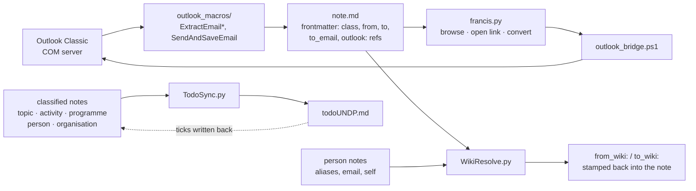
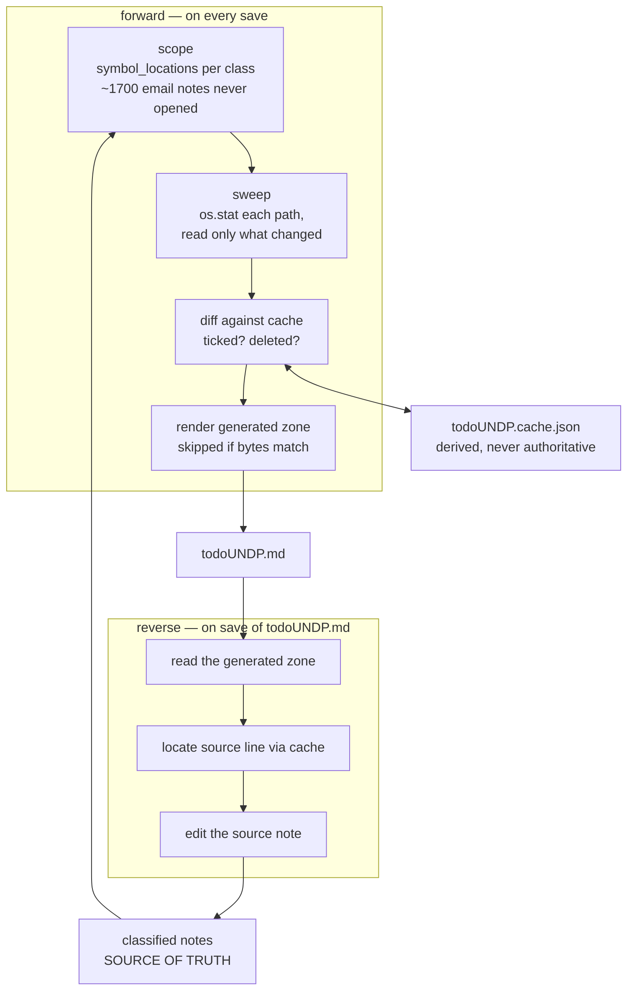
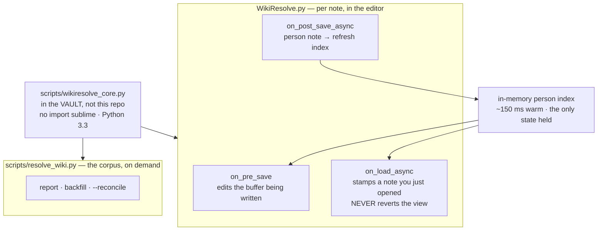
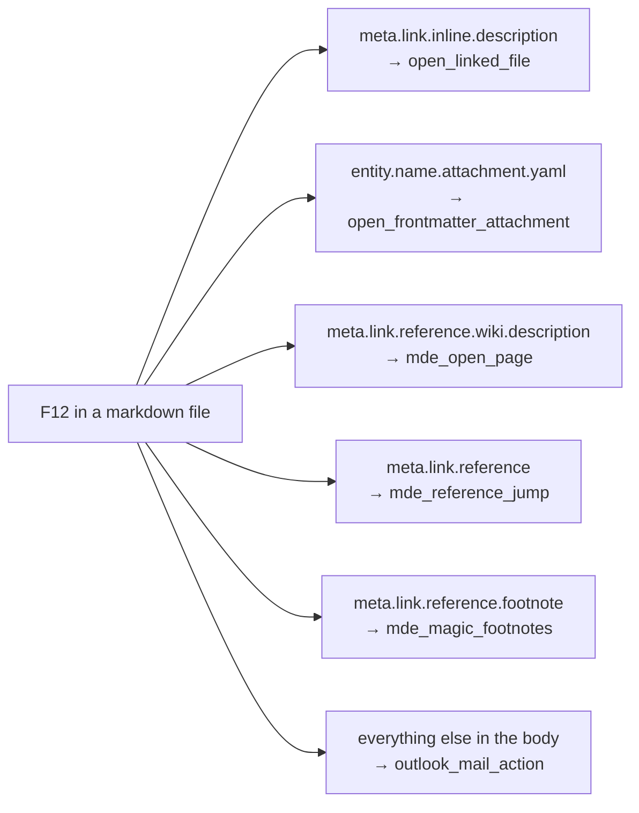

# Markdown-Note-Harness

A Sublime Text 4 package that turns a folder of Markdown notes into a working
inbox: wiki-linking, todo syncing, Office-to-Markdown conversion, and a bridge
back to the Outlook Classic messages the email notes came from.

Depends on **MarkdownEditing**, and overrides some of its commands. Lives in
`Packages/Markdown-Note-Harness/` and is loaded directly from disk — there is
no build step.

`CLAUDE.md` is the detailed reference: architecture, the macro/plugin contract,
and the design constraints that are expensive to rediscover. This file is the
map.

## What's in here

| file | what it does |
|---|---|
| `francis.py` | Markdown link and attachment opening, Office→Markdown conversion, email browsing, and the Outlook actions |
| `TodoSync.py` | Sweeps unchecked todos out of classified notes into `todoUNDP.md` and writes resolutions back to the source notes |
| `TodoSync.sublime-settings` | Which note classes get swept. Override it in `Packages/User/` |
| `WikiResolve.py` | Stamps the derived `from_wiki:` / `to_wiki:` keys onto the note you save or open. The logic itself lives in the vault |
| `WikiResolve.sublime-settings` | Where the vault core and the person notes are. Override it in `Packages/User/` |
| `outlook_bridge.ps1` | PowerShell COM bridge to Outlook Classic. Inert to Sublime; reached only via `subprocess` from `francis.py` |
| `MarkdownExtended.sublime-syntax` | Adds a scope for unchecked todos, for colour and the per-file symbol list |
| `YAMLEmailFrontmatter.sublime-syntax` | Adds scopes for the email frontmatter fields the macro writes |
| `Symbol List - *.tmPreferences` | Rewrites those scopes into the `_note` symbol tokens the commands look up |
| `outlook_macros/` | The VBA that produces the email notes, imported by `git subtree`. Runs in Outlook, not in Sublime |
| `tests/` | Two headless suites — `test_todosync.py` and `test_wikiresolve.py`. Run by hand; nothing runs them for you |
| `wiki_page_FOR_MARKDOWN_EDITING.txt` | A patched copy of MarkdownEditing's `wiki_page.py` — see below |

## How the pieces fit



Three things are worth reading off that picture. The macros are the only
**producer** of email notes — nothing in Sublime creates one. The arrow from
`todoUNDP.md` back to the notes is the only place a generated file writes into a
hand-written one. And `outlook_bridge.ps1` is the only path back to a live
Outlook item, which is what makes a threaded reply possible at all.

## Commands

All are in the command palette; the ones with a keybinding say so.

**Email notes**

- *Email: Browse* — every indexed email in one list, narrowed by typing `/toreply`,
  `/priority` or `/personal`, with `/subject` and `/sender` swapping which field
  the search matches. Highlighting a row previews it with the frontmatter folded.
- *Email: Open all to-reply* — opens every to-reply note in tabs.
- *Email: Open original in Outlook* — `F12` with the caret in the body of a note,
  anywhere that isn't a link. Acts on the live Outlook item the note was exported
  from, so a reply lands in the original thread. Outlook writes the quoted block
  and the threading headers itself.
- *Email: Resolve in Outlook (diagnostic)* — runs the whole lookup and touches
  nothing. The safe probe when a note won't open.
- *Reply to email* — the `mailto:` fallback. Needs nothing from Outlook, but starts
  a new conversation rather than threading.

The reply / reply-all / forward variants are built — `outlook_mail_action` takes
`action` — but **commented out** in `francis.sublime-commands` and unbound. Scope
cannot tell them apart, so each would need a key of its own.

**Todos**

The notes are the source of truth. `todoUNDP.md` is re-derived from them on every
save; a todo ticked in either place is ticked in the other.

- *Todos: Sweep now* — rebuild the overview. Runs automatically on save of any
  Markdown file, and on load of `todoUNDP.md`.
- *Todos: Apply overview edits* — push ticks and `!` toggles from the overview back
  into the notes. Runs automatically on save of `todoUNDP.md`.
- *Todos: Show scope* — which notes are being swept, and why. The one to reach for
  while classifying.
- *Todos: Rebuild cache* — throw away the derived cache and re-read everything.



A note is swept when its frontmatter `class:` is listed in
`TodoSync.sublime-settings` — `topic`, `activity`, `programme`, `person` and
`organisation` today. Adding a class is a frontmatter edit plus a settings edit;
no code change, and a note classified for the first time shows up on the save
that classified it.

Saving anything else — an email note, an unclassified note, a template — does
nothing at all: the class is read from the buffer, so there is no index lookup and
no file read. And a sweep that finds no change doesn't rewrite `todoUNDP.md`, so
there is no OneDrive churn and an open overview isn't reverted under your cursor.

`todoUNDP.md` has three zones: a hand-written `# Capture` zone at the top (swept
like any other note, so quick capture needs no special case), the generated zone
between the `todosync:` markers, and `## Completed` at the bottom. Only the middle
one is ever rewritten, so pruning `- [x]` lines out of your notes does not disturb
the history.

Delete `todoUNDP.cache.json` and the next sweep rebuilds it identically. It exists
to gate reads on `(mtime, size)`, to tell *completed* from *deleted*, and to find
the source line behind an overview line.

**Wiki resolution**

The Outlook macro writes display names — `from: "[[@Demba Tandia]]"` — and person
notes are camelCase basenames, so 92% of the vault's wikilinks pointed at no file.
`WikiResolve.py` stamps the derived `from_wiki:` / `to_wiki:` (and
`organizer_wiki:` / `attendees_wiki:`) keys that close that gap.

- *Wiki: Show person index* — every person note the resolver can see, its address
  and alias counts, the `self` marker, and any ambiguous key at the top. A person
  missing here is a person the on-save stamp cannot resolve.
- *Wiki: Rebuild person index* — re-read every person note.



The split is deliberate and load-bearing: the batch pass used to live in the
plugin and caused two incidents, both in Sublime's lifecycle rather than in the
logic — a startup sweep that rewrote 1,745 notes three seconds after launch, and a
crash on every email note opened, from reverting a view inside its own load
callback. Neither was reachable by the tests. A command you invoke, whose report
you read before it writes, is the right shape for batch work.

Resolution walks four tiers, and stops at the first hit:

| tier | match | measured on the real corpus |
|---|---|---|
| t0 | an address — `from_email:`, or a recipient written as a bare address | 597 of 10,057 recipient entries are bare addresses; `to_email:` now makes this the common path for new notes |
| t1 | an exact normalised `aliases:` entry | **6,036 of 11,803** — the curated alias lists are the mechanism |
| t2 | the note's title or basename, camel-split *and* verbatim | 15 between them |
| t3 | token-set equality, so `Inguscio Agostino` meets `Agostino Inguscio` | ↑ |

There is no t4 by bare first name: it collides. A key two person notes both claim
resolves to **nothing**, is reported, and is never guessed. Entries resolving to
the vault owner — `self: true` in `francis.md` — are dropped, not counted as gaps;
that is 1,661 of 11,803.

Two rules the whole design rests on. **Always write the key**: empty means
*resolved to nothing*, absent means the resolver has never run. And the automatic
paths are **monotone** — they fill an empty key and append newly resolved names,
and never clear a value or shorten a list, so a half-mounted vault cannot silently
delete every link to someone. Only `resolve_wiki.py --reconcile` removes anything.

**Other**

- *Convert Office File to Markdown* — .docx / .pptx via Pandoc, .pdf via marker-pdf.
- *Open Markdown Link* — `F12` on a Markdown link, or on an attachment name in
  frontmatter.
- *Select wiki reference* — `Tab` inside `[brackets]` in a Markdown file.

`super+alt+z` opens the current repo in Sublime Merge.

### What F12 does, and why the selector is load-bearing



Sublime runs the **last** matching binding across the merged keymap, and package
order is ASCII — so this package always wins over MarkdownEditing and ordering
inside `Default.sublime-keymap` can never hand a scope back. The only tool for
that is the selector, which is why the Outlook binding reads
`text.html.markdown - (meta.link | markup.underline.link | entity.name.attachment.yaml)`.
Every subtracted scope is exactly the scope some other F12 binding needs. Anything
new bound to F12 across the whole of `text.html.markdown` must subtract the same
set.

Nothing in a scope distinguishes an email note from any other Markdown file, so
`OutlookMailActionCommand.is_enabled` is what keeps that wide binding honest —
without it, every F12 in `todoUNDP.md` would spawn PowerShell for a certain
failure.

## The Outlook round trip

```
Outlook Classic ──ExtractEmail*──▶ note.md ──▶ browse / reply / forward
   (COM server)                    carries      in Sublime
        ▲                          entry_id         │
        └───── outlook_bridge.ps1 ◀── subprocess ───┘
```

The macros in `outlook_macros/` write each note's frontmatter with a foldable
`outlook:` list of back-references (`entry_id`, `store_id`, `message_id`,
`conversation_id`). `OutlookMailActionCommand` reads those and asks Outlook to act
on the real item — the only way to reply *inside* a thread, since `mailto:` cannot
set `In-Reply-To` or Outlook's conversation properties.

A note carrying that block resolves in one `GetItemFromID` — `store_id` included,
without which Outlook only searches the default store and archives resolve to
nothing.

**Legacy notes** — everything exported before the macro grew the `outlook:` block
— are found by their `subject` instead, narrowed by `from_email` and then `date`.
Outlook's Inbox, Sent Items and Deleted Items are searched; a unique survivor is
opened, and anything else — no match or several — hands the subject to Outlook's
own search box and raises the window, which is a better answer than a wrong guess.

Measured over a random sample of 40 legacy notes: **39 open directly, 1 lands in
the search box.** Typically 1–4s; the worst realistic case — a subject shared by 29
messages in one thread, resolved by sender and date — took 10s.

Two details worth knowing, because both look like bugs otherwise:

- The subject is matched as a `LIKE` on its longest word and then compared exactly
  *after sanitising*, never as an equality filter. Frontmatter subjects written
  before 2026-08 had `: ? / \ " < > | [ ]` stripped by the filename sanitiser, so
  `Re: Draft PS Invitation` is stored as `Re Draft PS Invitation`.
- Note dates are occasionally an hour out from Outlook's received time. No filter
  is ever allowed to empty the candidate set, so a drifted date costs you the
  search box rather than a wrong message.

`sent:` notes reach neither path: `.Send` re-keys the item, so they have no
`entry_id`, and their date is a send time the stored copy does not share. A note
whose message has genuinely been archived or deleted reports and stops.

## Tests

```
"%USERPROFILE%\.local\bin\python3.14.exe" tests/test_todosync.py
"%USERPROFILE%\.local\bin\python3.14.exe" tests/test_wikiresolve.py
```

Both stub `sublime` and `sublime_plugin` and build a throwaway vault in a temp
directory, so neither needs the editor. They must stay in `tests/` — Sublime only
auto-loads plugins from the package root, and a file that assigns a fake into
`sys.modules["sublime"]` would break every plugin in the process if it were loaded.

`test_wikiresolve.py` is thin on purpose: it covers finding the vault core, the
class gate, the `on_pre_save` buffer edit, and that the view is **never** reverted
— the crash regression. The resolution logic is tested where it lives, with no
stubbing at all, in `<vault>/scripts/tests/test_wikiresolve_core.py`.

The VBA is not tested by anything. Editing a `.vba` file here changes nothing
until it is pasted into Outlook's VBE (Alt+F11) and the module re-imported.

## `wiki_page_FOR_MARKDOWN_EDITING.txt`

Kept as `.txt` so Sublime does not load it: it is a modified copy of
MarkdownEditing's `wiki_page.py`, meant to *replace* that file inside the
MarkdownEditing package rather than to run alongside it. It makes wiki links and
back links search the whole project, and makes the make-page-reference command
double single brackets into wiki brackets and offer every Markdown file for
insertion. (The odd `self.view.insert` calls that made this work were never fully
understood.)

## Next steps

- Backfill: the subject search already knows the ids it found, so writing them into
  the note would make the next open an O(1) lookup. Not built — it edits your notes.
- A `message_id` fallback, for archived mail whose `entry_id` Outlook has re-keyed.
  `message_id` and `conversation_id` are captured today but not yet consumed.
- Keybindings for the reply / reply-all / forward variants, and uncommenting them
  in the palette. *Open* has `F12`; the other three need a key each, since scope
  cannot tell them apart.
- Backfill `to_email:` onto the 1,722 notes exported before the macro wrote it.
  They still resolve, but by display name rather than by address.
